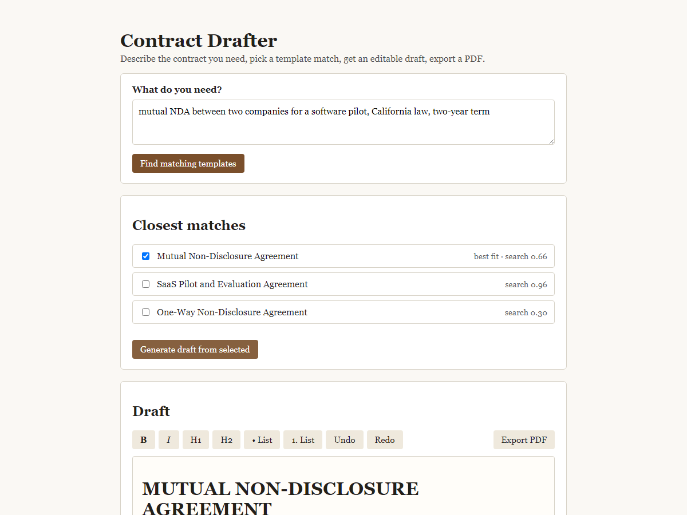

# Contract Drafter

A small prototype that turns a plain-language request into a contract draft.



What it does:

1. You type a request, for example "mutual NDA between two companies for a software pilot, California law, two-year term".
2. The app searches a pool of contract templates and returns the closest matches.
3. The model uses the top match (or top few) as the base and writes a full draft, filling in the details you gave and leaving anything unknown as a visible placeholder like [PARTY A NAME] or [EFFECTIVE DATE].
4. The draft opens in an editable rich text editor in the browser, with placeholders highlighted so they are easy to spot and fill in.
5. An export button sends the edited draft to the backend and returns a formatted PDF.

## Quick start

Requires Python 3.12.

Windows:

```
py -3.12 -m venv .venv
.venv\Scripts\activate
pip install -r requirements.txt
copy .env.example .env
uvicorn app.main:app --reload
```

Mac/Linux:

```
python3.12 -m venv .venv
source .venv/bin/activate
pip install -r requirements.txt
cp .env.example .env
uvicorn app.main:app --reload
```

Open http://localhost:8000. No config is required to run it. Without an API key the app runs in demo mode: search falls back to a keyword ranking (BM25) instead of embeddings, and the draft step returns the top template with its placeholders instead of a model-written draft. Set LLM_API_KEY in .env to turn on real search and drafting.

Run the tests with `pytest`. They run fully offline in demo mode.

## Pointing it at OpenAI or a local model

The app talks to any OpenAI-compatible chat and embeddings API, set through env vars in `.env`:

```
LLM_BASE_URL=https://api.openai.com/v1
LLM_API_KEY=sk-...
LLM_MODEL=gpt-4o-mini
EMBED_MODEL=text-embedding-3-small
```

For a local model through Ollama, run `ollama serve` and pull a chat model and an embedding model (for example `qwen2.5:14b-instruct` and `nomic-embed-text`), then set:

```
LLM_BASE_URL=http://localhost:11434/v1
LLM_API_KEY=ollama
LLM_MODEL=qwen2.5:14b-instruct
EMBED_MODEL=nomic-embed-text
```

Ollama ignores the API key value but the client library still expects one, so any non-empty string works.

## How search works

At startup the app reads every template in `templates/` (plain .txt, or .docx through python-docx) and embeds each one. A request is ranked two ways at once: cosine similarity on the embeddings, and a BM25 keyword score that counts a hit on the template title three times as much as a hit in the body. The two scores are blended to get a shortlist of three.

Embeddings alone tend to follow the topic instead of the document type. "An NDA for a software pilot" sits closer to the pilot agreement than to the NDA. So the chat model gets the shortlist titles and picks the order by document type, and the draft is written from that top pick. With no API key the app skips both model steps and ranks with BM25 only.

PDFs are made with xhtml2pdf because it installs with pip on Windows with no system libraries. On a Linux server I would switch to WeasyPrint for better typography.

## What I would change for production

- Swap the in-memory numpy search for a real vector database once the template pool grows past a few hundred documents.
- Add authentication and per-user draft history.
- Add DOCX export alongside PDF.
- Build out a proper clause library instead of whole-document templates, so drafts can be assembled clause by clause.
- Have a lawyer review the template library and the prompt before this touches a real contract.

The sample templates in `templates/` are generic examples written for this prototype. They are not legal advice and should not be used as-is for a real agreement.
